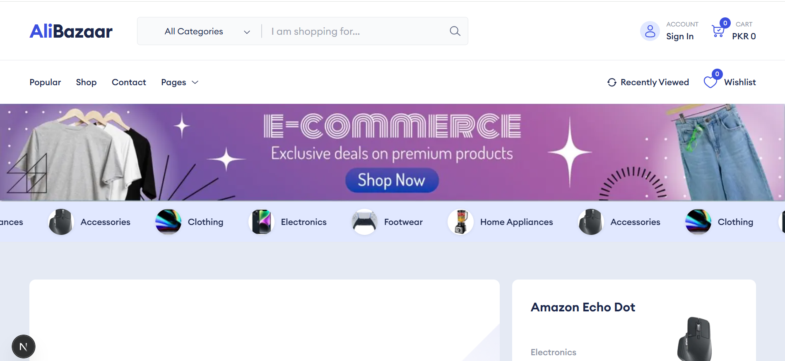
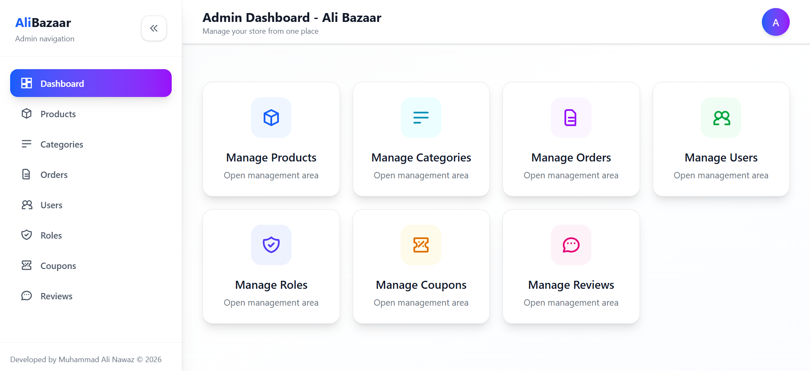
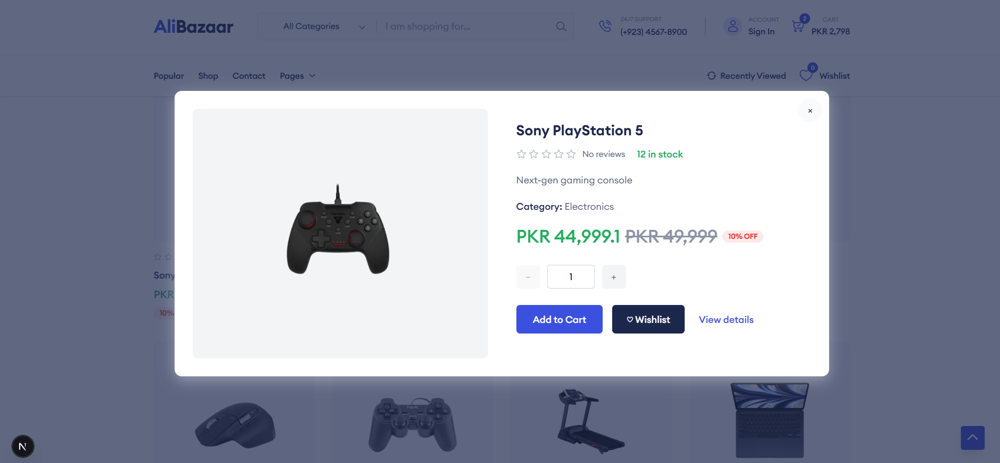
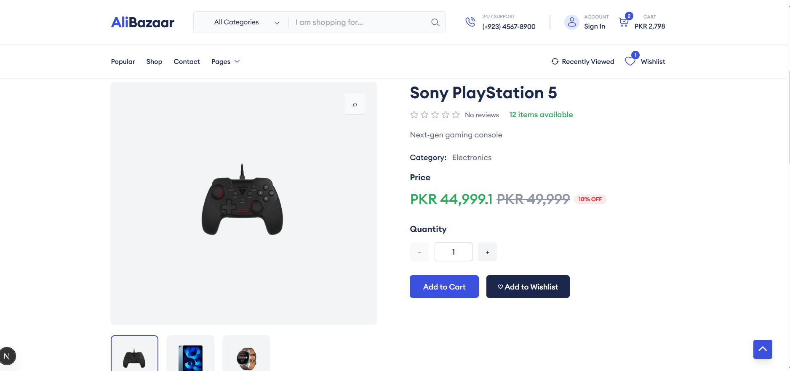
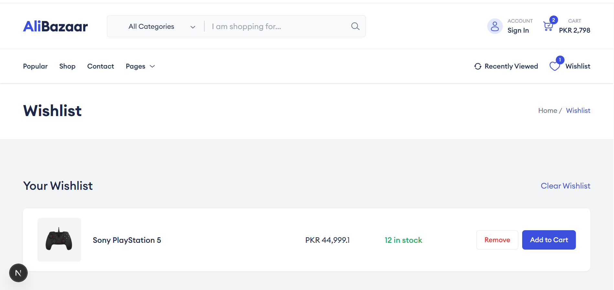
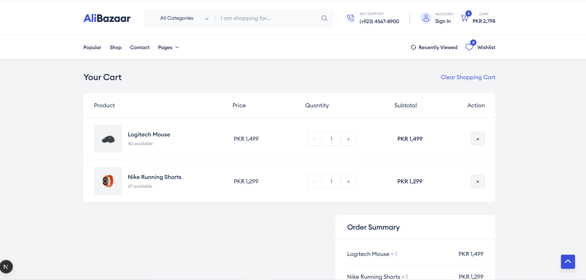

<div align="center">

# 🛍️ AliBazaar

### Full-Stack E-Commerce Platform for the Pakistani Market

A modular e-commerce application built with a **Next.js customer storefront**, a dedicated **React/Vite admin dashboard**, a **NestJS REST API**, **TypeORM**, and **MySQL**.


</div>

---

## 📌 Project Overview

**AliBazaar** is a full-stack online shopping platform designed around a modern three-application architecture:

1. A customer-facing **Next.js storefront**.
2. A separate **React/Vite administration dashboard**.
3. A modular **NestJS backend API** connected to **MySQL** through TypeORM.

Customers can register, browse and search products, manage carts and wishlists, apply coupons, complete checkout, track orders, manage their profiles, and submit verified reviews. Administrators can manage products, categories, users, roles, coupons, reviews, orders, and order status transitions.

---

## ✨ Core Features

### Customer Storefront

- Responsive online shopping interface
- Product catalog with category and keyword filtering
- Product detail pages with multiple images
- Product discounts and PKR price display
- Customer registration and authentication
- HTTP-only cookie-based customer sessions
- Persistent server-side shopping cart
- Customer wishlist
- Recently viewed products
- Coupon validation and discount calculation
- Mock checkout mode for demonstrations
- Stripe Payment Intent integration
- Order creation and order history
- Public order tracking by order number
- Customer profile and password management
- Profile-image upload support
- Verified product reviews with optional images
- Dynamic customer testimonials
- Authenticated contact form
- SEO metadata, sitemap, robots file, and web manifest

### Admin Dashboard

- Administrator authentication
- JWT bearer-token authorization
- Protected admin routes
- Product creation, editing, deletion, and image uploads
- Category creation and management
- User account management
- Role creation and activation management
- Coupon and compensation-coupon management
- Order search, filtering, details, and status updates
- Review moderation and visibility controls
- Storefront redirect and reusable admin page layout

### Backend API

- Modular NestJS architecture
- MySQL persistence with TypeORM
- Explicit database migrations
- DTO validation with `class-validator`
- Global input whitelisting and rejection of unknown fields
- Role-based access control for `admin` and `user`
- Password hashing with bcrypt
- JWT extraction from bearer tokens or secure cookies
- Helmet security headers
- Configurable CORS with credentials support
- Local image upload handling with file validation
- Stock reservation during checkout
- Automatic release of expired checkout reservations
- Mock and Stripe payment-provider support
- Stripe webhook handling
- Order status history
- Shipment records and delivery estimates
- Coupon redemption tracking and limits
- Unit tests for core services, controllers, guards, and DTOs

---

## 🖼️ Application Screenshots

| Application Preloader |
|---|
|  |

| Homepage | Admin Dashboard |
| --- | --- |
|  |  |

| Product View | Product Details |
| --- | --- |
|  |  |

| Wishlist | Shopping Cart  |
| --- | --- |
|  |  |

---

## 🧱 System Architecture

```text
┌──────────────────────────────┐
│ Next.js Customer Storefront  │  http://localhost:3000
│ React 19 + Redux Toolkit     │
└───────────────┬──────────────┘
                │ Cookie-authenticated HTTP requests
                │
┌───────────────▼──────────────┐
│ NestJS REST API              │  http://localhost:5000
│ DTO Validation + RBAC        │
│ Checkout + Orders + Reviews  │
└───────┬───────────┬──────────┘
        │           │
        │           ├──────────────► Stripe / Mock Payments
        │           ├──────────────► SMTP Contact Delivery
        │           └──────────────► Local Upload Storage
        │
┌───────▼──────────────────────┐
│ MySQL Database               │
│ TypeORM Entities/Migrations  │
└──────────────────────────────┘

┌──────────────────────────────┐
│ React/Vite Admin Dashboard   │  http://localhost:5173
│ Bearer-token authentication  │
└───────────────┬──────────────┘
                └──────────────► NestJS REST API
```

---

## 🧰 Technology Stack

### Storefront

- Next.js 16 App Router
- React 19
- TypeScript
- Redux Toolkit
- React Redux
- Tailwind CSS 3
- Swiper
- Stripe React SDK
- Next.js Image and Metadata APIs

### Admin Dashboard

- React 19
- Vite 7
- React Router DOM 7
- Axios
- Tailwind CSS 4
- JavaScript / JSX

### Backend

- Node.js
- NestJS 11
- TypeScript
- TypeORM
- MySQL 8+
- Passport JWT
- bcryptjs
- class-validator
- class-transformer
- Helmet
- Multer
- Stripe SDK
- NestJS Scheduler

### Testing and Code Quality

- Jest
- ts-jest
- Supertest
- ESLint
- Prettier

---

## 📁 Repository Structure

```text
AliBazaar/
├── backend/
│   ├── src/
│   │   ├── auth/                 # Login, session, JWT strategy, cookies
│   │   ├── cart/                 # Customer cart operations
│   │   ├── category/             # Public and admin category management
│   │   ├── checkout/             # Mock/Stripe checkout and reservations
│   │   ├── common/               # Guards, decorators, interfaces, uploads
│   │   ├── contact/              # Authenticated contact-form delivery
│   │   ├── coupon/               # Discounts and compensation coupons
│   │   ├── migrations/           # TypeORM schema migrations
│   │   ├── order/                # Orders and status history
│   │   ├── payment/              # Payment records and webhook support
│   │   ├── product/              # Products, images, pricing, search
│   │   ├── review/               # Reviews and moderation
│   │   ├── role/                 # Role management
│   │   ├── shipment/             # Shipment and delivery state
│   │   ├── user/                 # Customer and managed-user accounts
│   │   ├── wishlist/             # Customer wishlist
│   │   ├── app.module.ts
│   │   ├── data-source.ts
│   │   └── main.ts
│   ├── test/
│   ├── uploads/defaults/         # Versioned fallback images only
│   ├── .env.example
│   ├── adminlogin.ts             # Admin seeding script
│   ├── product.ts                # Product seeding script
│   └── package.json
├── frontend/
│   ├── web/                      # Next.js customer storefront
│   │   ├── public/
│   │   ├── src/app/
│   │   ├── src/components/
│   │   ├── src/hooks/
│   │   ├── src/lib/
│   │   ├── src/redux/
│   │   ├── .env.local.example
│   │   └── package.json
│   └── dashboard/                # React/Vite admin dashboard
│       ├── public/
│       ├── src/components/
│       ├── src/lib/
│       ├── .env.example
│       ├── vercel.json
│       └── package.json
├── .gitignore
├── LICENSE
└── README.md
```

---

## ✅ Prerequisites

Install the following before running the project:

- **Node.js 20.9 or newer**
- **npm 10 or newer**
- **MySQL 8 or newer**
- Git

Optional integrations:

- Stripe test account
- SMTP email account

---

## 🚀 Local Development Setup

The repository contains three independent Node.js applications. Install and run each application from its own directory.

### 1. Clone the Repository

```bash
git clone https://github.com/CodeByMan/AliBazaar-Ecommerce.git
cd AliBazaar-Ecommerce
```

### 2. Create the MySQL Database

Open MySQL and run:

```sql
CREATE DATABASE ecommerce
  CHARACTER SET utf8mb4
  COLLATE utf8mb4_unicode_ci;
```

You may use a different database name by changing `DB_DATABASE` in the backend environment file.

### 3. Configure the Backend

```bash
cd backend
cp .env.example .env
```

Windows Command Prompt:

```bat
cd backend
copy .env.example .env
```

Update `.env` with your local database credentials and a strong JWT secret.

```env
PORT=5000
NODE_ENV=development

DB_HOST=localhost
DB_PORT=3306
DB_USERNAME=root
DB_PASSWORD=your_mysql_password
DB_DATABASE=ecommerce
DB_SYNCHRONIZE=false
DB_LOGGING=false

JWT_SECRET=replace_with_a_long_random_secret
JWT_EXPIRES_IN=1d
AUTH_COOKIE_NAME=alibazaar_session
AUTH_COOKIE_MAX_AGE_MS=86400000

CORS_ORIGINS=http://localhost:3000,http://localhost:5173
PAYMENT_PROVIDER=mock
```

Install backend packages:

```bash
npm ci
```

Run the database migrations:

```bash
npm run migration:run
```

Create the administrator and demo products:

```bash
npm run seed:admin
npm run seed:products
```

Start the API:

```bash
npm run start:dev
```

The backend runs at:

```text
http://localhost:5000
```

### 4. Configure the Customer Storefront

Open a second terminal:

```bash
cd frontend/web
cp .env.local.example .env.local
npm ci
npm run dev
```

Windows Command Prompt:

```bat
cd frontend\web
copy .env.local.example .env.local
npm ci
npm run dev
```

The storefront runs at:

```text
http://localhost:3000
```

### 5. Configure the Admin Dashboard

Open a third terminal:

```bash
cd frontend/dashboard
cp .env.example .env
npm ci
npm start
```

Windows Command Prompt:

```bat
cd frontend\dashboard
copy .env.example .env
npm ci
npm start
```

The admin dashboard runs at:

```text
http://localhost:5173
```

---

## 🔐 Local Administrator Account

The administrator seeding command reads these values from `backend/.env`:

```env
ADMIN_USERNAME=admin
ADMIN_PASSWORD=Admin@123
```

Default local login:

```text
Username: admin
Password: Admin@123
```

> Change the default administrator password before deploying or sharing a live environment. Never use the example password in production.

Customers are created through the storefront registration page.

---

## ⚙️ Environment Variables

### Backend — `backend/.env`

| Variable | Purpose | Required |
| --- | --- | --- |
| `PORT` | NestJS server port | No |
| `NODE_ENV` | `development`, `test`, or `production` | Yes |
| `DB_HOST` | MySQL host | Yes |
| `DB_PORT` | MySQL port | Yes |
| `DB_USERNAME` | MySQL user | Yes |
| `DB_PASSWORD` | MySQL password | Yes |
| `DB_DATABASE` | MySQL database name | Yes |
| `DB_SYNCHRONIZE` | TypeORM automatic schema sync | No; keep `false` with migrations |
| `DB_LOGGING` | TypeORM query logging | No |
| `JWT_SECRET` | JWT signing secret | Yes |
| `JWT_EXPIRES_IN` | JWT lifetime | Yes |
| `AUTH_COOKIE_NAME` | Customer session cookie name | No |
| `AUTH_COOKIE_MAX_AGE_MS` | Cookie lifetime in milliseconds | No |
| `CORS_ORIGINS` | Comma-separated allowed frontend origins | Yes |
| `PAYMENT_PROVIDER` | `mock` or `stripe` | Yes |
| `STRIPE_SECRET_KEY` | Stripe secret API key | Stripe only |
| `STRIPE_WEBHOOK_SECRET` | Stripe webhook signing secret | Stripe only |
| `DELIVERY_CHARGE_PKR` | Standard delivery fee | No |
| `FREE_DELIVERY_THRESHOLD_PKR` | Free-delivery threshold | No |
| `CHECKOUT_RESERVATION_MINUTES` | Stock-reservation duration | No |
| `DELIVERY_ESTIMATE_DAYS` | Estimated delivery duration | No |
| `ADMIN_USERNAME` | Seeded administrator username | Seed only |
| `ADMIN_PASSWORD` | Seeded administrator password | Seed only |
| `CONTACT_TO_EMAIL` | Contact-form destination | Email only |
| `SMTP_HOST` | SMTP server host | Email only |
| `SMTP_PORT` | SMTP server port | Email only |
| `SMTP_SECURE` | Enable implicit TLS | Email only |
| `SMTP_STARTTLS` | Upgrade connection with STARTTLS | Email only |
| `SMTP_REJECT_UNAUTHORIZED` | Reject invalid TLS certificates | Email only |
| `SMTP_USER` | SMTP username | Email only |
| `SMTP_PASS` | SMTP password | Email only |
| `SMTP_FROM_EMAIL` | Contact-form sender address | Email only |

### Storefront — `frontend/web/.env.local`

| Variable | Purpose |
| --- | --- |
| `NEXT_PUBLIC_SITE_URL` | Public storefront URL |
| `NEXT_PUBLIC_API_BASE_URL` | NestJS API URL |
| `NEXT_PUBLIC_IMAGE_BASE_URL` | Backend upload URL |
| `NEXT_PUBLIC_STRIPE_PUBLISHABLE_KEY` | Stripe publishable key |
| `NEXT_IMAGE_ALLOW_LOCAL_IP` | Permit local backend images during development |
| `BACKEND_API_URL` | Optional server-side rewrite destination for `/api/*` |

### Admin Dashboard — `frontend/dashboard/.env`

| Variable | Purpose |
| --- | --- |
| `VITE_API_BASE_URL` | NestJS API URL |
| `VITE_IMAGE_BASE_URL` | Backend upload URL |
| `VITE_STOREFRONT_URL` | Customer storefront URL |

> Real `.env` files are intentionally ignored by Git. Commit only the provided example files.

---

## 📜 Available Commands

### Backend

Run from `backend/`:

| Command | Description |
| --- | --- |
| `npm run start:dev` | Start NestJS in watch mode |
| `npm run build` | Compile the backend |
| `npm run start:prod` | Run the compiled backend |
| `npm test` | Run Jest unit tests |
| `npm run test:watch` | Run tests in watch mode |
| `npm run test:cov` | Generate test coverage |
| `npm run test:e2e` | Run end-to-end tests |
| `npm run lint` | Run ESLint with automatic fixes |
| `npm run format` | Format TypeScript files with Prettier |
| `npm run migration:run` | Apply pending TypeORM migrations |
| `npm run migration:show` | Display migration status |
| `npm run migration:revert` | Revert the latest migration |
| `npm run seed:admin` | Create the administrator account |
| `npm run seed:products` | Insert demo categories and products |

### Customer Storefront

Run from `frontend/web/`:

| Command | Description |
| --- | --- |
| `npm run dev` | Start the Next.js development server |
| `npm run build` | Create a production build |
| `npm start` | Run the production build |
| `npm run lint` | Run ESLint |

### Admin Dashboard

Run from `frontend/dashboard/`:

| Command | Description |
| --- | --- |
| `npm start` | Start the Vite development server |
| `npm run build` | Create a production build |
| `npm run preview` | Preview the production build |
| `npm run lint` | Run ESLint |

---

## 🔌 Main API Routes

The backend currently exposes routes directly from the API root. There is no global `/api` or `/api/v1` prefix.

### Public and Customer Routes

| Method | Route | Description |
| --- | --- | --- |
| `POST` | `/auth/login` | Authenticate an administrator or customer |
| `GET` | `/auth/session` | Read the current authenticated session |
| `POST` | `/auth/logout` | Clear the customer session cookie |
| `POST` | `/user/register` | Register a customer |
| `GET` | `/user/check-username` | Check username availability |
| `GET` | `/user/profile` | Read the customer profile |
| `PATCH` | `/user/update/profile` | Update customer profile fields/image |
| `PATCH` | `/user/change-password` | Change customer password |
| `GET` | `/products` | List and filter products |
| `GET` | `/products/details/:id` | Product details and reviews |
| `GET` | `/categories` | Public active categories |
| `GET` | `/cart` | Read customer cart |
| `POST` | `/cart/add` | Add a product to cart |
| `PUT` | `/cart/update/:id` | Update cart quantity |
| `DELETE` | `/cart/remove/:id` | Remove a cart item |
| `GET` | `/wishlist` | Read customer wishlist |
| `POST` | `/wishlist/toggle` | Add/remove a wishlist item |
| `GET` | `/checkout/config` | Read checkout configuration |
| `POST` | `/checkout/mock` | Complete a mock checkout |
| `POST` | `/checkout/payment-intent` | Create a Stripe Payment Intent |
| `POST` | `/checkout/confirm` | Finalize a Stripe order |
| `GET` | `/orders` | List the customer's orders |
| `GET` | `/orders/mine/:orderNumber` | Read a customer-owned order |
| `GET` | `/orders/track/:orderNumber` | Public order tracking |
| `GET` | `/coupons/my` | List customer compensation coupons |
| `POST` | `/coupons/validate` | Validate a coupon |
| `POST` | `/reviews` | Submit a verified review |
| `GET` | `/reviews/testimonials` | Public testimonial feed |
| `POST` | `/contact` | Send an authenticated contact message |

### Administrator Routes

| Module | Main Routes |
| --- | --- |
| Products | `/products`, `/products/:id`, `/products/details/:id` |
| Categories | `/categories/admin`, `/categories`, `/categories/:id` |
| Users | `/user`, `/user/admin`, `/user/admin/:id`, `/user/:id/details` |
| Roles | `/roles`, `/roles/:id` |
| Coupons | `/coupons`, `/coupons/:id`, `/coupons/compensation`, `/coupons/:id/assign` |
| Orders | `/orders/admin/list`, `/orders/admin/:orderNumber`, `/orders/admin/:orderNumber/status` |
| Reviews | `/reviews/admin/list`, `/reviews/admin/:id/visibility`, `/reviews/admin/:id` |
| Shipments | `/shipment/admin/:orderId` |
| Payments | `/payment/:id` |

---

## 💳 Payment Modes

### Mock Mode

The default local configuration is:

```env
PAYMENT_PROVIDER=mock
```

Built-in demonstration card behavior:

```text
Successful payment: 4242 4242 4242 4242
Declined payment:   4000 0000 0000 0002
Expiry:             Any future month/year
CVC:                Any 3 or 4 digits
```

Mock mode is suitable for local demonstrations and academic evaluation. It does not charge real cards.

### Stripe Mode

Set:

```env
PAYMENT_PROVIDER=stripe
STRIPE_SECRET_KEY=sk_test_...
STRIPE_WEBHOOK_SECRET=whsec_...
```

Storefront:

```env
NEXT_PUBLIC_STRIPE_PUBLISHABLE_KEY=pk_test_...
```

Stripe webhook endpoint:

```text
POST /payment/webhook
```

Use Stripe test keys during development.

---

## 🗄️ Database and Migration Notes

- The backend uses TypeORM entities and versioned migrations.
- Keep `DB_SYNCHRONIZE=false` in shared and production environments.
- Apply migrations before running seed scripts.
- Seed scripts skip existing matching records where appropriate.
- Local database dumps and backup files are excluded by `.gitignore`.

Core data areas include:

- Authentication and roles
- Customers
- Categories and products
- Product images
- Cart and wishlist entries
- Checkout sessions
- Orders and order items
- Order status history
- Payments and shipments
- Coupons and coupon redemptions
- Reviews

---

## 🧪 Testing and Validation

Backend tests:

```bash
cd backend
npm test
```

Backend coverage:

```bash
npm run test:cov
```

Production builds:

```bash
cd backend && npm run build
cd ../frontend/web && npm run build
cd ../dashboard && npm run build
```

Before opening a pull request, run the linters in all three applications.

---


## 👨‍💻 Author

**Muhammad Ali Nawaz**  
Full-Stack Software Developer  

---

## 📄 License

This project is licensed under the [MIT License](LICENSE).

---

<div align="center">

Built and maintained by **Muhammad Ali Nawaz**.

⭐ Star the repository if you find the project useful.

</div>